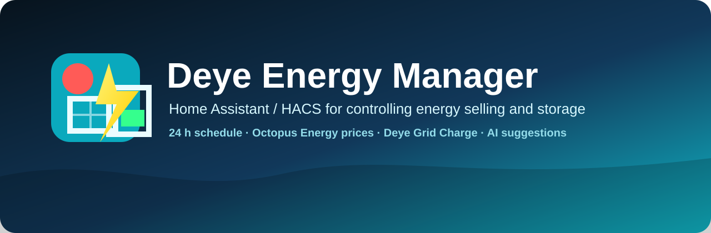

# Deye Energy for Home Assistant



[](CHANGELOG.md)
[](#quick-start)
[](LICENSE)
[](#requirements)

Deye Energy is a custom Home Assistant integration for planning and safely
controlling a Deye hybrid inverter. It combines a 24-hour manual schedule, the
six physical Deye Time Of Use (TOU) ranges, energy prices, Solcast forecasts and
statistics in a family of Lovelace cards. It is adapted to a Deye inverter
exposed through MQTT (the Sunsynk / Deye add-on profile) and to a UK-style
tariff.

> **Release 0.8.1.06:** simplifies Power Flow to Power/Today periods, renders
> mid-line tangent-oriented arrows on flow paths, halves glow-ball count with a
> consistent 0–5000 W speed scale, and aligns the Inverter Configuration Power
> Flow layout selector with other config fields. Manual Schedule remains
> independent from physical Deye TOU and the unused stored 48-slot model remains
> removed.

## Key features

- **Manual Schedule** with variable-length rows covering the full 24 hours and
  the three logical modes **Normal Operation**, **Charging** and **Selling**.
  Rows use whole-minute `HH:MM` boundaries and can be any number of rows, as
  long as they cover the full day without gaps/overlaps. Manual Schedule is
  independent from physical Deye TOU: while active, its rows drive the
  integration's timed control decisions; when inactive, manual rows remain saved
  but no integration schedule/TOU actions are triggered from them.
- **Exact source/control separation**: Manual Schedule activation controls
  whether manual rows are the timed control source. The master **Deye control**
  switch remains a separate hardware gate. Physical TOU is edited directly and
  is not auto-triggered by the integration.
- **Six physical Deye TOU ranges** as direct inverter TOU editing/baseline,
  editable inline in the **Deye Time Of Use** table with whole-minute `HH:MM`
  boundaries (for example `0:00`, `23:30`); Deye `H:MM` options are accepted.
  Save validates the whole day; **Refresh** reloads the local rows from the
  inverter and discards unsaved edits — it does not write to the inverter. The
  inverter's 6-range physical TOU limit applies to physical TOU, not Manual
  Schedule rows.
- **Single-phase inverters** are supported by default; set
  `layout.phase_count: 3` where separate L1/L2/L3 readings are needed.
- **Power formatting:** the main card's live power readouts and backend decision
  text switch W→kW at 10 kW (2 decimals on the card, 1 decimal in backend
  decisions), while the generic `formatPower` helper used for Solcast/graph-style
  readouts switches at 1 kW with 2 decimals. Power-flow links switch at 10 kW and
  use 1 decimal in kW.
- **Prices** from Octopus Energy or any mapped entity, an Octopus tariff
  catalogue and a fully manual tariff mode.
- **Solcast forecast analysis** with history.
- **Transaction-safe control writes:** TOU and manual-schedule writes are
  diff-only, confirmed and rolled back on failure; inverter-configuration writes
  are confirmed but sequential and stop at the first failure (no rollback).
  Physical writes are blocked when Deye control is disabled or the inverter link
  is gated.
- **Automatically managed Lovelace resource** in the default UI/storage mode.
- **Diagnostics** for providers, entity mapping, data quality and the active
  schedule source.
- **Trigger logs** card (`custom:deye-energy-trigger-logs-card`) recording guarded
  inverter writes from the scheduler, TOU and manual schedule, with timestamp,
  target/value and success/failure status. Inverter time sync and the one-time
  startup capacity write are not logged. Full-height layout with sticky header,
  scrollable content, 20-entry pagination, time filters and 30-day/5000-entry
  retention; addable to any dashboard.
- **Graphs** card (`custom:deye-energy-graphs-card`) with 1h/6h/24h/7d/30d/1y
  history graphs and a custom From/To date+time range, in flat metric-group tabs
  with a bottom accent for Power flow, Inverter, Grid, Load, and Battery. The
  time-range buttons stay flat and **Apply range** commits a custom range.
  Charts render full-width within the selected group; default entity mappings
  are overridable in card config (including `entities.ac_output_voltage`);
  addable to any dashboard.
- **Power flow** card (`custom:deye-energy-power-flow-card`) showing live
  animated power flow between PV, Grid, Inverter, Battery and Home, with
  configurable layout (`cross` default, or `left_right`), straight/curved
  glowing links, directional arrows, glowing node widgets and per-node details
  for daily energy, voltage, current, temperature, SOC and configurable custom
  rows. The Grid node shows import/export energy and voltage by default, with no
  frequency row. Optional consumers (including `rest` untracked load), energy
  period switching (`power/today`), the battery sign convention
  in power mode (positive = discharging, negative = charging; display flipped),
  W/kW formatting (`<10000 W` in watts, `>=10000 W` in kW with one decimal),
  power-mode home load calculated from PV, grid and battery power, theme-aware
  node images with coloured active glow, an SOC bar coloured by charge level,
  and per-node click to open Home Assistant more-info are supported.

  A summary row above the four main nodes shows Overall grid (import/export
  power), Electricity (import energy and cost today), Gas (import and cost today)
  and Export (export energy and income today) by default; optional
  backend-configured summary chip groups can also appear, and both values in
  each widget share the same font format. The period selector is pinned to the
  top-right corner inside the diagram outline; the header shows only the title
  and live timestamp once data has loaded. Energy-period values keep the kWh unit
  on the same row.

  Active links carry discrete SVG glow balls: the base duration is
  `18 / flow_animation_speed` seconds (`flow_animation_speed` defaults to 6,
  clamped to 1–20), divided by `clamp(sqrt(abs(power) / 1000), 0.4, 3)` and
  clamped to 0.35–8 seconds, so higher link power means faster travel. Direction
  comes from the signed flow, so the arrowhead and ball travel always agree. A
  reversal runs a 1.6 s staged transition: dim the current glow and old arrow,
  cross-fade the arrowhead to the other end, re-brighten the glow and resume
  movement. Generic links show no arrow or balls at or below 10 W; Grid is
  boosted above that threshold whenever it imports or exports, so sub-watt Grid
  flows still animate while the Grid link is idle only at 0 W. The plain link
  always remains.

  The delegated click listener is installed on connect, removed on disconnect
  and restored on reconnect; animation frames stop while the card is detached.
  With the default detail rows, PV is 174×132 (70%×60% of the original node),
  Grid 174×154 (70%×70%), Home 174×165 (70%×75%) and Battery 223 px wide (90% of
  the original width) with a default height of 220 px; detail-row changes adjust
  heights and the canvas. PV, Grid and Home outer surrounds are 255 px wide like
  Battery, while their inner cards stay 174 px wide and start at Battery's 16 px
  left inset. The Inverter ring is 121 px radius with a 9 px stroke, smaller than
  the original 151/11, and node halos and link endpoints follow the surrounds.
  Layout can be switched in Inverter Configuration > Power Flow > "Power flow
  layout" (`cross` or `left_right`); left-right uses curved links and keeps the
  same glow-ball logic. With default detail rows in cross layout the visible gaps
  to the Inverter are 88.5 px for Grid and Home, 70 px for PV and 100 px for
  Battery on a 1200×1081 canvas; custom
  detail rows change the canvas height. The Inverter Temperature and Status rows
  are centred inside its ring. Grid has no frequency detail row by default, and
  detail-row label/value gaps are tighter. Entity mappings are overridable in
  card config in the order defaults → backend display settings → card config,
  and the card is addable to any dashboard.

## Requirements

- Home Assistant 2026.6 or newer;
- a Deye inverter whose entities are available in Home Assistant;
- **[Sunsynk / Deye Inverter Add-on (multi)](https://github.com/kbialek/deye-inverter-mqtt) by kbialek** — required only for the Sunsynk/Deye MQTT profile; ESPHome Deye (Lewa-Reka), Solarman and custom-mapping profiles do not require it, and the `deye_addon` profile is read-only;
- optional: the Solcast PV Forecast integration, a weather entity, an energy
  price entity.

## Supported inverter connections

| Profile | How the inverter reaches Home Assistant |
|---|---|
| **Sunsynk / Deye MQTT** (default) | Uses MQTT discovery entities published by **kbialek's Sunsynk / Deye Inverter Add-on (multi)**. Full control of work mode, sell power and the six TOU slots; battery current limits are set separately in **Inverter configuration**. |
| **ESPHome Deye Inverter — Lewa-Reka** | Uses ESPHome `select`, `time` and `switch` entities for work mode and TOU control. |
| **Solarman** | Uses Solarman `select` entities for work mode and TOU grid/export control. |
| **Deye Inverter MQTT** (read-only) | The pinned kbialek MQTT revision publishes safe readings but does not expose complete native control of work mode and the six TOU slots; control is refused (fail closed). |
| **Custom mapping** | Map any compatible entities and give the exact option values yourself. |

### Deye over MQTT

With the Sunsynk profile the default entity mapping already matches the usual
MQTT discovery names (`select.deye_load_limit`, `number.deye_max_sell_power`,
`number.deye_battery_max_charge_current`, `select.deye_prog1_time` …,
`sensor.deye_battery_soc`, `sensor.deye_grid_power` and so on). TOU time
options are exposed as `H:MM` (for example `0:00`, `23:30`) and the integration
accepts that format. Physical battery current number entities can be mapped in
the configuration wizard; the standalone **Inverter configuration** card
validates each value against the live entity's own range. Anything that does not
match can be re-mapped in the configuration wizard.

The wizard performs a **read-only capability test** before anything is saved
and lists which features (selling, charging and full TOU) are available for the
selected entities.

### Mirrored charge defaults

A fresh install uses safe defaults: 0 W sell power, grid charging enabled and a
100% charge target. Existing installations receive a one-time `sa_defaults_v1`
migration that replaces only the original grid-charge-disabled template; a
profile you have edited since is kept as-is. Battery charge, discharge and
grid-charge currents are no longer part of any profile or schedule. Set them
directly in the **Inverter configuration** card, which calls
`deye_energy.apply_inverter_configuration_group` and writes only the three
configured physical number entities. A positive grid-charge current is only a
limit; Grid Charge permission remains a separate TOU setting.

### Inverter configuration

The **Inverter configuration** card (`custom:deye-energy-inverter-config-card`)
is a standalone card, separate from the main Energy Manager settings. Add it
manually to any dashboard; the bundled `deye-energy` dashboard has only Manager,
Graphs and Power flow tabs.

The card groups inverter configuration in flat tabs with a bottom accent:
Inverter, Grid, Battery settings in inverter, Battery settings, Mode & control,
Specification, Voltages, Power, Battery, Energy, and Power flow. Live values are
loaded from the inverter every time the page is accessed and can be refreshed
manually. A field whose entity is missing, unavailable or has no usable metadata
is shown as **Not mapped** or **Unavailable** and stays read-only; the backend
refuses to write it.

Each editable group has its own **Apply** button. All values in the group are
prevalidated against the live entity's own `min`, `max`, `step` or `options`
before anything is written. Before upload, the card shows a confirmation overlay
with **Field | Previous (live) | New** values; upload happens only after explicit
confirmation. Writes then run sequentially and stop at the first failure (there
is no rollback). After a successful apply, the card refreshes live values. Two
response-only services expose the same behaviour:
`deye_energy.get_inverter_configuration` and
`deye_energy.apply_inverter_configuration_group` (fields `group` and `values`).

The three battery/grid current limits live in **Battery settings in inverter**
and are the only direct write path for those entities. Manual schedule rows,
profiles, defaults, manual sell/charge and automatic reconciliation never write
them.

**Inverter time sync**: The Inverter configuration card shows inverter and Home
Assistant time. Use **Sync now** to write the current Home Assistant time to the
configured inverter datetime entity. The backend also runs a periodic 6-hour
drift check and force-syncs the inverter clock when any hour, minute, or second
deviation is detected.

## Quick start

1. Install through HACS (custom repository) or copy
   `custom_components/deye_energy` into your `custom_components` folder.
2. Restart Home Assistant.
3. **Settings → Devices & services → Add integration → Deye Energy**.
4. Choose an inverter profile (for the kbialek MQTT add-on choose **Sunsynk**),
   then work through the wizard's device, mapping-mode, entity-selection
   (including the capability test) and price/forecast steps; review the summary
   and confirm.
5. Add the card to a dashboard:

   ```yaml
   type: custom:deye-energy-card
   ```

In the default **UI/storage mode** the integration automatically registers its
bundled card resource. In **YAML mode** add the resource manually:

```yaml
lovelace:
  resources:
    - url: /deye_energy/deye-energy-card.js?v=0.8.1.06
      type: module
```

See [INSTALL.md](INSTALL.md) for the full procedure.

## Manual Schedule and physical TOU ranges

**Manual Schedule** and **physical Deye TOU** are independent models.

- **Manual Schedule**: variable-length rows, whole-minute `HH:MM`, any number of
  rows, covering the complete 24 hours with no gaps/overlaps. When Manual
  Schedule is active and Deye control is active, the integration applies the
  active manual row's decision at minute boundaries. Manual rows do not auto-write
  physical TOU ranges.
- **Physical Deye TOU**: exactly six inverter ranges, edited directly in the
  Deye Time Of Use tab or via `set_tou_slot`. Physical TOU is direct inverter
  editing/baseline; the integration does not auto-trigger TOU/schedule writes
  from it.
- Manual rows do not overwrite physical work-mode or minimum sell-price fields.
- Battery charge, discharge and grid-charge current limits are not part of the
  schedule and are changed in **Inverter configuration**; a manual row's
  **Battery charge** toggle controls the grid-charge enable switch, not a current
  limit.
- Disabling Manual Schedule leaves rows saved but inactive; no integration
  schedule/TOU actions are triggered from inactive manual rows.

The manual table columns are **From**, **To**, **Mode**, **Sell power**,
**Grid charging**, **Battery charge**, **Stop selling at SOC**, **Active** and
**Action**. Rows are read-only by default; use the edit icon to change a row, and
**Save** to leave edit mode. Enable/Disable saves internally without clearing
edit mode; new rows start read-only, and removing a row asks for confirmation.
The row covering the current time has a slow amber/orange text/icon glow so the
active window is easy to spot. The manual header also contains the shared
Settings gear and Deye control button.
The gear opens **Settings and diagnostics** on its **Tariff and distribution**
tab by default; the only other tab is **System and diagnostics**.

Manual rows use `minimum_sell_soc` for **Stop selling at SOC**; legacy `tou_soc`
on manual rows is ignored. The physical TOU SOC stays with each physical TOU
range, separate from the manual rows.

## Deye Time Of Use

The **Deye Time Of Use** tab maps the full day onto the inverter's six physical
Deye ranges. Physical TOU is direct inverter editing/baseline; it is not
auto-triggered by the integration, and Manual Schedule is independent from it.
The six rows are read-only until the header **Edit** button is used; then
start/end, mode, charge, sell, power, voltage and SOC are inline controls. The
first From and last To are fixed at `00:00`, and each To follows the next row's
From.

- **Save** validates the entire day before writing: it must start at `00:00`,
  end at `00:00` and have no gaps, overlaps or non-positive durations, with SOC
  between 0 and 100% and non-negative power/voltage. Errors appear below the
  table and name the affected range.
- **Refresh** (internally a rollback of local edits) force-refreshes the TOU
  entities from the inverter, discards all local edits, rebuilds every row from
  the live values and reports the result. It does not write to the inverter.
- **Refresh** and **Edit** sit in the header; **Save** is in the footer. Save is
  disabled for read-only providers, during a local save and while Deye control
  is not Active; a pending backend TOU write is also rejected. Refresh is
  disabled only during a local save.
- The tab keeps the operation status and schedule-synchronisation summary, so
  confirmed writes and reverse-sync changes remain visible.

## Settings and diagnostics

The shared Settings gear opens a single overlay with two tabs:

- **Tariff and distribution** (the default tab) for the tariff provider, plan
  and manual rates;
- **System and diagnostics** for connection status, required entities, mapping,
  physical TOU read-back, capabilities, last apply attempt and backup/restore
  controls.

There is no separate Mode settings, profile-form, mapping or history overlay.
Manual rows are edited in the **Manual schedule** tab and the six physical TOU
ranges are edited inline in the **Deye Time Of Use** tab; inverter current
limits are edited in the standalone **Inverter configuration** card. The backend
services `deye_energy.save_charge_profile`, `deye_energy.save_normal_profile`
and `deye_energy.save_default_settings` remain registered for automations and
API calls. `deye_energy.apply_settings` and
`deye_energy.get_power_flow_display` also remain registered; their historical
behaviour is documented in the release notes.

## Octopus Energy, tariff and currency

Prices and cost values are displayed with GBP units (`GBP/kWh`, `GBP`). The
integration is set up for **Octopus Energy** through the Octopus Energy Home
Assistant integration:

| Item | Default |
|---|---|
| Tariff | Intelligent Octopus Go (`intelligent_go`) |
| Manual peak rate | `0.3281` GBP/kWh (32.81 p/kWh) |
| Manual off-peak rate | `0.066` GBP/kWh (6.60 p/kWh) |
| Bundled off-peak window | `23:00–05:00` (the IOG source title also notes 23:30–05:30) |
| Import price entity | `sensor.electricity_<serial>_<mpan>_current_rate` |
| Export price entity | `sensor.octopus_energy_electricity_<serial>_<mpan>_export_current_rate` |

The **Octopus Energy** price adapter understands two kinds of entity:

- the Octopus Energy `current_day_rates` / `next_day_rates` event entities, whose
  `rates` list holds half-hourly `value_inc_vat` prices (averaged into hours,
  so Agile works when those events are enabled);
- the `current_rate` sensors, whose `start`/`end` attributes define a validity
  window (a flat export rate such as Outgoing covers today and tomorrow).

The bundled `tariff_catalog.json` lists Octopus Energy products. Intelligent
Octopus Go uses the selected seller tariff's rates; the bundled DSO entry adds
`0` because account unit rates already include distribution. Agile needs the
rates events, and Flexible has no fixed bundled rate — enter your unit rate in
manual mode or map the Octopus rates entities. Change the plan or enter your own
values under the gear's **Tariff and distribution** tab.

### Known limitations of the tariff engine

- the daily **standing charge** is not modelled; `56.61 p/day` is a documented
  example figure, not a value read from the catalog or price entities;
- manual rows and physical TOU boundaries accept whole-minute `HH:MM`. Price
  rows and the manual tariff engine are hourly; the
  bundled/default off-peak zone is `23:00–05:00`, although the product source
  title mentions `23:30–05:30`;
- there is no manual flat export rate (for example a fixed 12 p/kWh): export
  value comes from the export price entity you map;
- Intelligent Octopus Go dispatch slots are not used for pricing.

## Safety

- Schedule decisions are made locally from the active manual rows or physical
  TOU ranges and live sensor readings.
- This software **does not replace hardware protection** of the inverter or
  the battery; keep the limits configured on the inverter itself.
- Missing SOC or sell-price readings block Selling First schedule entries and
  apply safe defaults; they do not block every write. Disabled Deye control
  blocks physical writes, and a failed Schedule TOU readback/mapping preflight
  blocks the schedule write.
- The master **Deye control** switch blocks every physical write.

## Development

```bash
python3 -m pytest -q                    # full Python suite
for file in tests/*.js; do node "$file"; done  # all frontend suites
```

See [CONTRIBUTING.md](CONTRIBUTING.md). Issues:
<https://github.com/maverik-77/deye-energy/issues>.

## Upstream project

This English edition is adapted from the original
[deye-energy-manager](https://github.com/pasierbrg/deye-energy-manager) project.
The original copyright notice is kept in [LICENSE](LICENSE).
