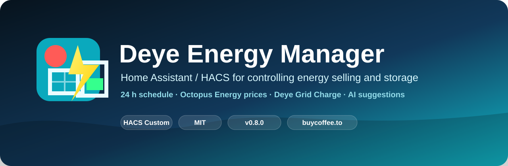

# Deye Energy for Home Assistant



[](CHANGELOG.md)
[](#quick-start)
[](LICENSE)
[](#requirements)

Deye Energy is a custom Home Assistant integration for planning and safely
controlling a Deye hybrid inverter. It combines a 24-hour schedule, the physical
Deye Time Of Use (TOU) slots, energy prices, Solcast forecasts, statistics, a
deterministic Optimizer Core and optional AI suggestions in a single Lovelace
card.

This project is an English-language fork of
[pasierbrg/deye-energy-manager](https://github.com/pasierbrg/deye-energy-manager)
(MIT licence). It has been translated and adapted to a Deye inverter that is
integrated through MQTT (the Sunsynk / Deye add-on profile) and to a UK-style
tariff. The original copyright notice is kept in [LICENSE](LICENSE).

## Key features

- a schedule of 24 one-hour slots;
- three logical modes: **Normal Operation**, **Charging** and **Selling**;
- Deye mapping of the 24 h plan onto the six physical TOU ranges (6/6);
- an editor for the physical Deye Time Of Use with actual / expected / status;
- a master **Deye control** switch that blocks every physical write when off;
- transactional, diff-only writes with confirmation and rollback;
- price sources (Pstryk, PSE/RCE, any entity) plus a tariff catalogue and a
  fully manual tariff mode;
- Optimizer Core, FuturePlan for today / tomorrow and safe just-in-time (JIT)
  execution;
- Solcast forecast analysis with history, and optional **advisory-only** AI
  suggestions;
- an automatically managed Lovelace resource in the default UI/storage mode;
- diagnostics for providers, entity mapping and data quality.

## Requirements

- Home Assistant 2026.6 or newer;
- a Deye inverter whose entities are available in Home Assistant;
- optional: the Solcast PV Forecast integration, a weather entity, an energy
  price entity.

## Supported inverter connections

| Profile | How the inverter reaches Home Assistant |
|---|---|
| **Sunsynk** (default) | Sunsynk / Deye add-on publishing over **MQTT** discovery. Full control of work mode, sell power, battery currents and the six TOU slots. |
| Deye add-on (read-only) | `kbialek/deye-inverter-mqtt` readings only; control is refused (fail closed). |
| Solarman | Solarman integration entities. |
| Lewa-Reka | ESPHome Deye Inverter. |
| Custom | Map any entities and give the exact option values yourself. |

### Deye over MQTT

With the Sunsynk profile the default entity mapping already matches the usual
MQTT discovery names (`select.deye_load_limit`, `number.deye_max_sell_power`,
`number.deye_battery_max_charge_current`, `select.deye_prog1_time` …,
`sensor.deye_battery_soc`, `sensor.deye_grid_power` and so on). TOU time
options are exposed as `H:MM` (for example `0:00`, `23:30`) and the integration
accepts that format. Battery current limits up to 320 A are accepted.
Anything that does not match can be re-mapped in the configuration wizard.

The wizard performs a **read-only capability test** before anything is saved
and lists which features (selling, charging, full TOU, Core/AI) are available
for the selected entities.

## Quick start

1. Install through HACS (custom repository) or copy
   `custom_components/deye_energy` into your `custom_components` folder.
2. Restart Home Assistant.
3. **Settings → Devices & services → Add integration → Deye Energy**.
4. Choose the inverter communication type (for MQTT choose **Sunsynk**), select
   the inverter device, review the mapped entities and confirm.
5. Add the card to a dashboard:

   ```yaml
   type: custom:deye-energy-card
   ```

In the default **UI/storage mode** the integration automatically registers its
bundled card resource. In **YAML mode** add the resource manually:

```yaml
lovelace:
  resources:
    - url: /deye_energy/deye-energy-card.js?v=0.8.0.44
      type: module
```

See [INSTALL.md](INSTALL.md) for the full procedure.

## Tariff and currency

Prices are shown in pounds (£). The default tariff mode is **manual** with the
UK tariff pre-filled:

| Item | Value |
|---|---|
| Standard rate | 34.56 p/kWh (`0.3456`) |
| Off-peak rate | 6.60 p/kWh (`0.066`), 23:30–05:30 |

Enter your own values in the card under **Settings → Tariff and distribution**.

### Known limitations of the tariff engine

- the daily **standing charge** is not modelled;
- the engine works on hourly slots, so the 23:30 off-peak start is rounded to
  a whole hour (the default window is 23:00–05:00);
- there is no manual flat export rate (for example a fixed 12 p/kWh): export
  value comes from the sell-price entity or the price source you map;
- `tariff_catalog.json` is **illustrative sample data only** (placeholder DSOs,
  suppliers and rates, not real tariffs). It is used only in automatic tariff
  mode; keep the default manual mode and enter your own rates. Price mappings
  use `GBP/kWh` or `GBP/MWh`.

## Safety

- All calculations are deterministic and run locally in the Optimizer Core.
- The optional AI assistant is **advisory only**: it can explain or comment on
  a plan but cannot write to the inverter or the schedule.
- This software **does not replace hardware protection** of the inverter or
  the battery; keep the limits configured on the inverter itself.
- Missing SOC, price or readback data always fails closed: no write happens.
- The master **Deye control** switch blocks every physical write.

## Development

```bash
python3 -m unittest discover -s tests          # most tests
python3 -m pytest tests                        # needs pytest, pyyaml
node tests/test_tou_editor.js                  # example frontend test
```

See [CONTRIBUTING.md](CONTRIBUTING.md). Issues:
<https://github.com/maverik-77/deye-energy/issues>.
